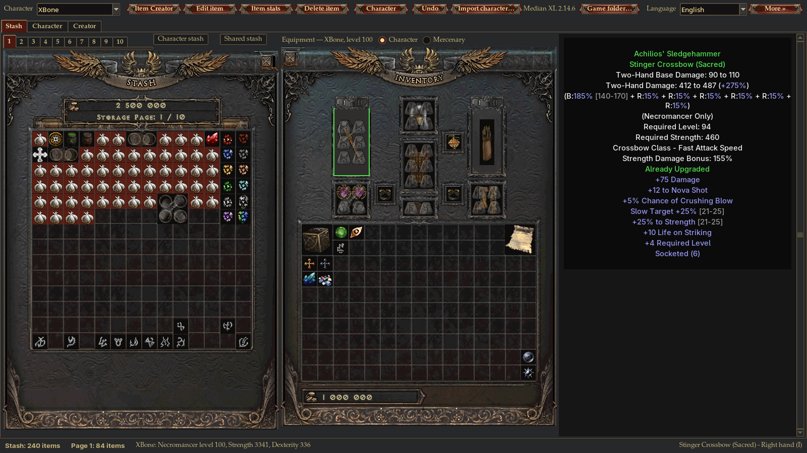

# MXL Capybara Editor V2

An offline item creator and character editor for **Median XL**, built on top of MXL Item Collector.



## Features
- **Item Creator**: make unique, set, runeword, Angelic, rare, magic, superior or normal items, including mystic orbs and other special misc items.
- **Edit / Delete item**: edit any stash item in the creator and write it back in place. A backup is made before every change.
- **Equipment and inventory next to the stash**: drag items between the stash, the inventory, the equipment slots and the mercenary.
- **Character window** (in the style of the old Hero Editor): stats and level-up, inventory, waypoints and quests for Normal, Nightmare and Hell.
- Safe writes: the game may stay open — this build removes the editor's game-closed checks, every file is verified, and backups are kept.
- Languages: English, French, Vietnamese (`lang/`).

## New in V2
V2 is a fork of [capybara-heroeditor](https://github.com/Nugwa628/capybara-heroeditor) 1.2. Everything below is
unique to it.

**How it is checked.** Every addition passes the editor's automated test suite, which works on copies of sample
saves in a virtual display and checks that each change writes exactly the right bytes. The stat screen's numbers
(damage, attack rating, life, mana, defense, block, resistances) have been compared with the running game and
match it. The Windows build has only been run under Wine, not on real Windows. Keep your backups, and please
report what you find.

**Editing**
- **Unrestricted editing**: any stat (id, parameter, value) can be added to, changed on or removed from any item;
  the save format is the only limit. The game may stay open while you edit.
- **Item stats tab** in the style of Hero Editor's Magic Attributes list: compact numbered slots with the value,
  level and skill editable in place (skills and classes by name), and a stat picker with categories, a Recent list
  and a Find box that searches every category as you type. Fully usable from the keyboard. The x in the first
  column deletes a stat.
- **Stat parameters by name**: for stats that carry a parameter, the editor shows what it means and lets you pick
  it by name: the skill and level of "chance to cast" stats, the class, the element and attribute of innate
  elemental damage, the mystic orb, the state. Typing `#N` sets a raw number.
- **Right-click menus on every item** (stash, equipment, mercenary, inventory): Edit, Item stats, Duplicate,
  Copy / Cut / Paste, Move to page, Delete, Change quality, Quantity, Export / Import item, and Hero Editor's
  "Specific editing functions" (defense, durability, ethereal, sockets, personalize, clear magic attributes,
  fill / remove socketed items, magic-attributes buffer).
- **Fill sockets with ...**: copy a gem, rune or jewel, then fill an item's free sockets with copies of it. An item
  with too few sockets gets more first, up to what its base allows (with "Unrestricted", any weapon or armor up
  to 6). Not offered where it cannot work, such as runewords.
- **Socket an item**: drag a gem, rune, jewel or other socket filler onto an item with a free socket (stash or
  character, either way) and it goes into that socket, as in the game; Ctrl+Z undoes it. In the Item Editor
  (Edit item), a free socket offers *Insert copied ...* for a copied socket filler.
- **Make perfect**: one click raises every roll of an item to the top of its range. Mystic orb additions are
  recognised and kept. It replaces the value sliders of the main window.
- **Edit items where they are**: equipped, mercenary and inventory items can be edited from the Stash tab, without
  moving them to the stash first.
- **Undo** (Ctrl+Z, 50 steps) for delete, create, replace, paste, quantity, quality, ethereal, personalize, Make
  perfect and Item stats edits; Delete key removes the item under the cursor. An undone delete puts the item back
  at its old place in the file, so the file ends up exactly as before, also when it was the only item on its page.
- **Change quality** to rare, crafted or tempered and **"Which set / unique?"** work from the right-click menu;
  **Move to page** uses the first free spot when the item's own spot is taken.
- **Edits that change nothing leave the item as it was**, byte for byte: "Edit item" followed by Replace without
  changes no longer gives the item a new id, resets durability, drops socketed items or changes quantities.
- **Honorific items** (quality 9) are read, shown and kept intact (the original editor crashed on characters
  holding one), and can be made in the Item Creator.
- Item details follow the mouse: hovering an item shows its stats.

**Item Creator**
- Rolls are typed number fields (Up / Down, PgUp / PgDn step them) with Min / Random / Max buttons, instead of
  sliders.
- Stats are added through the same slot list and categorised picker as the Item stats tab; the picker completes
  what you type.
- Honorific is one of the qualities.
- Unique relics are listed by the skill they grant ("Relic - Bladestorm"); entries with the same name are told
  apart (by their bonus line, "[not dropped]" or their table row), and empty placeholder rows are hidden.
- The search also matches the bonuses an item comes with ("stormlord" finds Arrogance).
- Pickers accept typing (Enter takes the exact, prefix or substring match).
- Barrels, crates, clusters and containers start at Quantity 1000.
- Stats deleted from an item no longer come back at 0 when it is edited again.
- **Runewords get all of their stats**: Median XL runewords have 13 property slots; every one of them is read
  (runewords made before missed their first slot and slots 9-13). A value the save format cannot hold is stored as
  the nearest value it can.
- Fits the window down to 800x600 at UI scale 1.25 (rows put the field under its label when narrow).
- Tooltips show damage the way the game does (no more "145 to 132" or "Adds 120-0").

**Character**
- **Stats page drawn like the game's character screen** (dark look): name, level, attributes and stat points are
  edited in place; the + buttons spend a stat point. Further pages: the game's two stat list pages (damage,
  pierce, speed, defenses and more), "All Item Attributes" and "Saved Values" (experience, skill points,
  life / mana / stamina, gold, hardcore and other flags, difficulty). Two pages are shown side by side when the
  window is wide enough. The light look has a plain page with the same fields.
- **The numbers match the game's character screen** (compared with the running game):
  - Damage and Attack Rating for the skill on each mouse button: the skill's share of weapon damage, its own
    physical and elemental damage and its attack rating bonus, at its level with all + skills;
  - weapon damage with ethereal (+25 % in Median XL), the items' elemental and poison damage, innate elemental
    weapons (% of an attribute, raised by Innate Elemental Damage), weapons without base damage, dual wield
    (one range per hand for Attack, both hands for weapon skills), numbers of 10,000 and more as "K";
  - life, mana, defense, mana regeneration and grit with the character's passive skills; Defense with dexterity
    and all Bonus to Defense; Block Chance; resistances with the difficulty penalty and their caps;
  - equipped items with their sockets, inventory charms, partial and full set bonuses, and per-level stats.
  Hovering a value explains how it is made up.
- The status bar shows the same Strength / Dexterity totals as the Stats page.
- **Skills page laid out like the in-game tree**: the game's panel, skill icons, tree web and tabs. Click a level
  box to type a level, left-click an icon for +1, right-click for -1. Hovering a skill shows its game tooltip,
  computed from the game's own tables for the character's levels (a few lines still show raw values). Skills whose
  required level or prerequisites are missing show their level in red, as in the game. The remaining skill points
  are shown as stored; changing levels does not spend them.
- **Mercenary page**: name, type, level / experience and whether it is dead. Every slot the mercenary can wear is
  shown in the Stash tab's equipment view.
- **Quests+ page**: every quest word of each difficulty with its bits, plus Re-open and Complete. The plain Quests
  page now writes the quest words the way the game does (the Act V word was wrong before).
- **Counters page**: Signets of Learning and Skill used, kill counters (achievements) and play time.
- **Hotkeys page**: the 16 skill hotkeys and the four mouse-button skills, with skill icons (also for Attack, skills
  from items and other classes' skills).
- Character tab edits stay pending until SAVE and survive changes made elsewhere in the meantime (for example an
  item moved from the Stash tab); RELOAD discards them.
- The Character dropdown loads the chosen character at once, and switching characters is fast.
- **Import character...** from a saved median-xl.com character page creates the character with its items, without
  carrying over anything of the template character (stash, mercenary, waypoints, counters).
- Copy / rename character: names the game refuses are refused, and a rename that fails half-way is rolled back.

**Safe saving**
- **Save check**: before every write, a second, independent save reader checks the new file (structure, size,
  checksum, item counts), and a one-line summary of what changed goes into `capybara.log`. The setting
  `savecheck` in `settings.json` (or the environment variable `MXL_SAVECHECK`) chooses what happens when the
  check fails: `strict` (default) refuses the write, `warn` writes it, shows a warning and keeps an extra backup,
  `off` turns the check off.
- **Compare with backup...** (in the "More »" menu) shows what differs between a save file and one of its backups,
  and can put the backup back.
- The same reader can be used by hand from the `tools/` folder: `python3 -m mxlsave verify <file>`,
  `python3 -m mxlsave dump <file>`, `python3 -m mxlsave diff <old> <new>`.
- **Out-of-date views are refused**: if the game wrote the stash after the editor read it, Delete, Edit, Copy, Cut,
  Duplicate, Export and Make perfect do nothing instead of acting on the wrong item.
- A save the game or an antivirus holds for a moment is retried; one that is refused shows an error, and a move
  to the stash is put back instead of leaving the item in two files.
- Characters whose name contains "gf" or with certain skill levels are read correctly; a quest reward that would
  push a stat over its maximum is capped instead of making the save fail.

**Interface**
- **Tabs instead of windows** (Stash, Character, Creator, Item stats): made for tiling window managers.
- **Dark Diablo theme** by default, built from Median XL's own UI art (stone, bronze, gold, the game's menu
  buttons); the Hero Editor light look is one checkbox away ("Dark D2 theme", applied at the next start).
- **Game-art stash and inventory**: in the dark look the stash and the character's equipment / inventory are drawn
  on Median XL's own in-game panels. Without the game files they are plain dark grids.
- **Compact layout, usable at 800x600**: cell sizes follow the window size, pages scroll only when they must, and
  toolbar items that do not fit move into a "More »" menu.
- **Fast**: the first start went from about 35 s to about 8 s, later starts take about 2.5 s; finding a free spot
  in a full stash takes milliseconds; scrolling (one mouse-wheel notch = one step) and character switching are
  quick; game art and stat sums are cached.
- **Hover tooltips work on Wayland compositors** such as Hyprland (no flicker, no fixed-size box).
- Switching the language updates the toolbar, tabs and footer at once; the Stash / Character / Creator tabs are
  translated.

**Platforms**
- **Native Linux AppImage** (no Wine): finds the Median XL save folder inside Wine, Lutris, Bottles, Steam
  (also Flatpak), Heroic and PlayOnLinux prefixes, opens at a size that fits the screen, and does not double-scale on HiDPI Wayland
  (`MXL_UI_SCALE=<factor>` to choose a scale). Text is antialiased (Tk built with Xft; plain X fonts as a
  fallback).
- Windows build from the same source tree, also buildable on Linux.

**Tests**
- A regression suite (`tools/run_tests.sh`, see [`tests/README.md`](tests/README.md)) runs the editor headless on
  copies of sample saves: no-op saves stay byte-identical, item and character edits change only what was asked,
  and every tab and page opens in both looks at 1280x720 and 800x600.

## Install
Download the latest build from the **[Releases page](https://git.wyrd.games/oroborius/capybara-editor-v2/releases)**
(or build it yourself, see [Building](#building)).

**Linux**: download `MXL_Capybara_Editor_V2-x86_64.AppImage`, make it executable (`chmod +x`) and run it. Settings and the log are
in `~/.local/share/MXL Capybara Editor/`. Set `MXL_SAVE_DIR=<folder>` to work on a copy of your saves.

**Windows**: download `MXL-Capybara-Editor-V2-windows.zip`, unzip it and run `MXL Capybara Editor V2.exe`.
Settings and the log are in `%LOCALAPPDATA%\MXL Capybara Editor\`.

On first start, choose the Median XL game folder. Backups are made before every change; you do not need to close
the game, changes show after its next save & exit.

## Reporting a problem
The editor keeps a log (`capybara.log` in the settings folder above), which records saves, backups, imports and errors.
Attach it to your bug report, along with the saved character page if the problem is with an import.

## Source
The Python source is in [`src/`](src). The editor is a set of modules added to the MXL Item Collector exe:
`repack.py` rebuilds the PyInstaller exe with these modules included, and `rsrc.py` sets the capybara icon.
See [`docs/DEVELOPER_NOTES.md`](docs/DEVELOPER_NOTES.md) for how each part works.

## License
[MIT](LICENSE). This covers the code in this repository only. MXL Item Collector, the Hero Editor art and the
Median XL game data belong to their respective authors.

## Credits
Hero Editor button art and the window layout come from Hero Editor 1.04 by ZonFire99 and Mastadex. Glory to the real Heroes.

## Building
Windows exe and native Linux AppImage, both from this source tree: see [`docs/BUILDING.md`](docs/BUILDING.md).

```
packaging/build_windows.sh      # dist/windows/MXL Capybara Editor V2/   (packaging\build_windows.ps1 on Windows)
packaging/build_appimage.sh     # dist/linux/MXL_Capybara_Editor_V2-x86_64.AppImage
```
